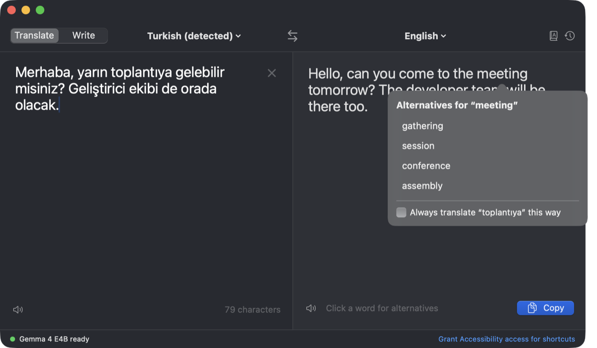
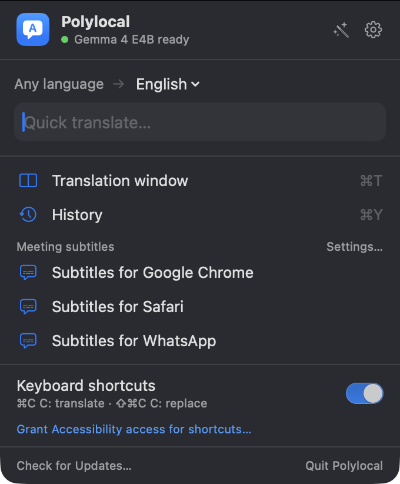

<div align="center">

# Polylocal

**Private, on-device translation for your Mac.**
Translate and rewrite text in any app, pick the right word like in DeepL, and follow meetings in another language, with an AI model that runs entirely on your Mac.

[](https://github.com/ardasnturk/polylocal/releases)
[](LICENSE)


[Download](https://github.com/ardasnturk/polylocal/releases/latest) · [Features](#features) · [Privacy](#privacy) · [Build from source](#build-from-source)



</div>

## Why Polylocal

- **Nothing leaves your Mac.** Translation, rewriting, speech recognition and summaries run on a local model. No account, no telemetry; the network is used only to download models and check for updates.
- **Works where you write.** Select text in any app and press ⌘C twice. Replace it in place, or get inline suggestions while you type.
- **You stay in control of the wording.** Click any word of a translation for alternatives, switch between formal and informal address, and teach it your own terms.
- **Free and open source** (MIT).

## Features

### Translate anywhere

| | |
|---|---|
| **⌘C C** | Select text in any app and press ⌘C twice: a popup streams the translation. |
| **⇧⌘C C** | Translate what you just wrote, preview it, and press ↩ to replace the original. |
| **Translation window** | A two-pane translator that translates as you type and detects the source language. |
| **Menu bar** | A quick translate field, recent actions and meeting subtitles, one click away. |
| **Inline suggestions** | Per app or website: write in one language and a translation appears under the caret. Tab accepts. |

### Get the wording right

- **Word alternatives.** Click a word (or select a phrase) in a translation to see other ways to say it. Pick one and the sentence is rebuilt around it, grammar included.
- **Remember a choice.** Tick “Always translate … this way” and the term goes into your glossary.
- **Formal or informal.** A one-click switch named the way the language does it: *Sie · du*, *siz · sen*, *vous · tu*, *usted · tú*… Remembered for each language.
- **Glossary.** Terms that must always be translated the same way; import from CSV.
- **Writing assistant.** Rewrite text in its own language: Correct, Fluent, Formal, Casual or Concise.
- **Copy your way.** A Copy button (⇧⌘C), or simply select the whole translation and it is copied. Read texts aloud with the system voices.

### Meeting mode (preview)

Live subtitles, in the language you choose, for what others say in Zoom, Google Meet, Teams, FaceTime or any other app, with speech recognition by Whisper on your Mac. Optionally:

- **Notes:** saves the original and translated transcript to a folder and writes a summary with decisions and action items after the meeting.
- **Hear the translation:** mutes the meeting app for you only and speaks the translation instead.
- **Speak the translation (beta):** translates what you say into the others' language and speaks it through **Polylocal Microphone**, a virtual microphone you pick in the meeting app. Installed from Settings → Meeting with your administrator password; “Speak directly” switches back to your own voice.

See [docs/MEETING_MODE.md](docs/MEETING_MODE.md) for how it works and what comes next.

<p align="center">
  
</p>

### And also

- **In-app updates** (Sparkle): checks once a day; download and install with one click.
- **Optional history:** off by default, stored only on this Mac and readable only by your user account.
- **20 languages, in any direction:** Turkish, English, German, French, Spanish, Italian, Portuguese, Dutch, Polish, Swedish, Greek, Azerbaijani, Russian, Ukrainian, Arabic, Persian, Chinese, Japanese, Korean and Hindi.
- **Interface in the same 20 languages,** following the macOS language order (Settings → General can override it). Translations other than English and Turkish were machine-assisted; corrections are welcome.

## Install

1. Download `Polylocal-<version>.dmg` from [Releases](https://github.com/ardasnturk/polylocal/releases). It is signed with a Developer ID and notarized by Apple.
2. Open it and drag **Polylocal** to Applications.
3. Launch it. The setup assistant asks for the Accessibility permission and downloads a model.

Later versions arrive through the app (menu bar → Check for Updates…).

**Requirements:** Apple Silicon Mac, macOS 14 Sonoma or later (meeting mode: 14.2), about 5 GB of free memory and 4.6 GB of disk space for the default model.

## Shortcuts

| Shortcut | Where | Action |
|---|---|---|
| ⌘C C | any app | Translate the selection in a popup |
| ⇧⌘C C | editable field | Translate, preview and replace the text |
| ⌘↩ | popup | Replace the selection with the translation |
| ⇧⌘C | translation window | Copy the translation |
| ⌘K | translation window | Clear the text |
| ⇧⌘S | translation window | Swap languages |
| Tab / ⌥Tab | inline suggestion | Accept / insert a real tab |
| Esc | popup, suggestion | Close |

Global shortcuts can be changed in Settings → General. The writing assistant has no shortcut by default; you can assign one. ⇧⌘C can collide with clipboard managers such as Raycast's Clipboard History; see [docs/COMPATIBILITY.md](docs/COMPATIBILITY.md).

## Privacy

Everything runs locally. Polylocal connects to the internet only to download models (Hugging Face, verified with SHA-256) and to read the update feed (`appcast.xml` on GitHub). There is no telemetry. History and meeting notes are off by default, the diagnostic log never contains your text, password fields are never read, and meeting audio is never saved. Details: [docs/PRIVACY.md](docs/PRIVACY.md).

## Models

Polylocal does not ship a model: you choose one in the setup assistant or in Settings → Models, and it is downloaded once.

| Model | Size | License | Notes |
|---|---:|---|---|
| Gemma 4 E4B (Q4_0) | 4.6 GB | Apache 2.0 | Default. Best quality in our benchmark; first token ~120 ms on an M4 Pro |
| Gemma 4 E2B (Q4_0) | 2.8 GB | Apache 2.0 | Lighter, for 8 GB Macs |
| Gemma 4 26B-A4B (Q4_0) | 14.6 GB | Apache 2.0 | Quality mode; needs 24 GB of memory |
| TranslateGemma 4B (Q4_K_M) | 2.5 GB | Gemma Terms of Use | Translation-only; weaker than Gemma 4 E4B for Turkish |
| Whisper large-v3 turbo (Q5_0) | 0.6 GB | MIT | Speech recognition for meeting mode |

The built-in engine is [llama.cpp](https://github.com/ggml-org/llama.cpp)'s `llama-server`, bundled in the app. If you already use [Ollama](https://ollama.com), Polylocal can use its models instead. Benchmark: [tools/bench/RESULTS.md](tools/bench/RESULTS.md).

## Build from source

Requires Xcode 16 or later (Swift 6) and `cmake` (`brew install cmake`).

```bash
git clone https://github.com/ardasnturk/polylocal.git
cd polylocal
scripts/build-llama-server.sh    # llama.cpp's llama-server (static, Metal)
scripts/build-whisper-server.sh  # whisper.cpp's whisper-server, for meeting mode
scripts/build-mic-driver.sh      # the Polylocal Microphone audio driver (libASPL), for speaking the translation
scripts/build-app.sh             # build/Polylocal.app (release)
open build/Polylocal.app
```

`scripts/build-app.sh debug` builds a debug configuration. Set `SIGN_IDENTITY` to sign with a specific identity; otherwise the first “Apple Development” identity is used, or ad-hoc signing as a last resort. Use a stable identity during development: macOS ties the Accessibility permission to the code signature.

Tests:

```bash
swift test
POLYLOCAL_NETWORK_TESTS=1 swift test                 # real download + SHA-256 verification (~60 MB)
POLYLOCAL_TEST_GGUF=/path/to/model.gguf swift test    # llama-server integration
```

Development aids: launch with `open --env POLYLOCAL_TRANSLATE="text" build/Polylocal.app` to open the translation window with a text (add `POLYLOCAL_ALTERNATIVES_FOR=word` to open its alternatives), `POLYLOCAL_PANEL_WINDOW=1` to show the menu bar panel in a window, or `POLYLOCAL_MEETING_SOURCE=<bundle id>` to start meeting mode for an app.

<details>
<summary>Releasing</summary>

```bash
VERSION=<x.y.z> NOTARY_PROFILE=<profile> scripts/make-dmg.sh   # signed, notarized DMG (needs dmgbuild: uv tool install dmgbuild)
VERSION=<x.y.z> scripts/update-appcast.sh                      # adds the release to appcast.xml (Sparkle feed)
```

Publish the GitHub release with the DMG as `Polylocal-<x.y.z>.dmg` under tag `v<x.y.z>`, then commit and push `appcast.xml`. Installed apps read the feed from the `main` branch.

</details>

## Project layout

| Path | Contents |
|---|---|
| [Sources/PolylocalCore](Sources/PolylocalCore) | Pure logic: languages, prompts, word alternatives, glossary, speech segmenting, meeting notes |
| [Sources/Engines](Sources/Engines) | OpenAI-compatible streaming client, `llama-server` and `whisper-server` processes |
| [Sources/ModelManager](Sources/ModelManager) | Model catalog, downloads, SHA-256 verification |
| [Sources/SystemIntegration](Sources/SystemIntegration) | Global shortcuts, Accessibility text capture and replace, app audio capture |
| [Sources/Polylocal](Sources/Polylocal) | The menu bar app and its UI |
| [Tests](Tests) | Swift Testing suites |
| [docs](docs) | [Architecture](docs/ARCHITECTURE.md), [compatibility](docs/COMPATIBILITY.md), [privacy](docs/PRIVACY.md), [meeting mode](docs/MEETING_MODE.md) |
| [tools](tools) | Model benchmark and compatibility test |

## Roadmap

Next: speaker labels and a per-meeting glossary ([meeting mode L5](docs/MEETING_MODE.md)), a Homebrew cask, and verified inline suggestions in browsers and Electron apps. See [docs/ARCHITECTURE.md §9](docs/ARCHITECTURE.md#9-roadmap).

## Contributing

Issues and pull requests are welcome. See [CONTRIBUTING.md](CONTRIBUTING.md).

## License

MIT. See [LICENSE](LICENSE). Third-party components are listed in [THIRD_PARTY_NOTICES.md](THIRD_PARTY_NOTICES.md). Models are not part of this repository and come with their own licenses.
