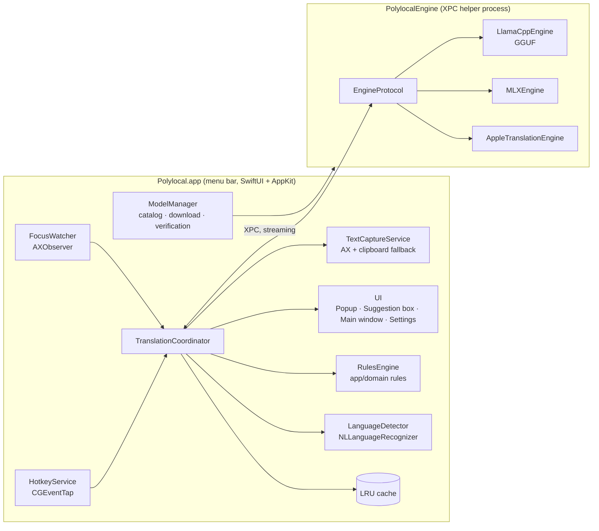

# Architecture

> Status: draft v0.2 · 2026-11-01 · phases 0–4 implemented

Polylocal is a free, open-source translation app for macOS. All translation is done by a local AI model downloaded to the user's Mac.

- **Idea taken from DeepL for Mac:** instant translation in any app via a shortcut.
- **Idea taken from Cotypist:** watching the text field and offering inline translation suggestions automatically.

---

## 1. Goals and principles

| Principle | Meaning |
|---|---|
| **100% local** | Text never leaves the device. The network is used only for model downloads and (optionally, once implemented) update checks. No telemetry. |
| **Works everywhere** | The Accessibility API gives access to the selected text and the text field in any app. |
| **Feels fast** | Translations stream: the first token appears within ~300 ms, an inline suggestion within ~700 ms. |
| **Model-agnostic** | The translation engine sits behind a protocol. Models and runtimes are interchangeable. |
| **No bundled model** | The app ships without a model. The user picks one from the catalog, downloads it, and accepts its license. |
| **Respectful integration** | Password fields are never touched. Features can be scoped per app or per domain. Text is never changed silently; every change requires user confirmation (Tab, Enter, or a click). |

**Out of scope (MVP):** document translation (PDF/DOCX), cloud engines, Windows/Linux, speech translation.

---

## 2. Usage modes

### Mode A — Quick translate (DeepL ⌘C C)
1. The user selects text in any app and presses **⌘C twice** (at most 400 ms between presses).
2. A small **popup** appears next to the cursor. The source language is detected automatically; the target language is the last used or the default one. The translation streams in.
3. Options:
   - **Copy**: ⌘C
   - **Replace**: ⌘↩ (only if the field is editable)
   - **Change target language / formality / Translate–Write mode**: pickers in the popup header
   - **Open in main window**: ⌘O
   - **Close**: Esc

### Mode B — Translate what you type (DeepL ⇧⌘C C)
1. While typing in an editable field, the user presses **⇧⌘C twice**.
2. The selected text is used (read via Accessibility, or via a simulated ⌘C when AX cannot read it).
3. The translation is previewed in the popup, where the target language can still be changed.
4. **↩** replaces the text in the field; the change can be undone with ⌘Z in most apps.
   *Planned:* using the whole field or the caret's paragraph when nothing is selected, and number keys for quick language picks.

Both shortcuts are customizable (single or double press, e.g. ⌃⌥C). Translations can use formal or informal address (e.g. Sie/du).

### Mode C — Inline translation suggestions (Cotypist-style)
1. The user defines a target language for an app or a domain. Example rules:
   - "English in TextEdit"
   - "The recipient's language in Gmail" (later phase)
2. As the user types, the app checks the detected language. **If the typed language differs from the target language** and the user pauses (~400 ms, end of sentence, or before Enter), a **translucent suggestion box** appears below the caret.
3. Keys:

| Key | What it does |
|---|---|
| **Tab** | Replaces the typed sentence or paragraph with the translation |
| **⌥Tab** | Sends a real Tab to the app |
| **Esc** | Dismisses the suggestion and stays quiet in that field for a few seconds |
| Keep typing | The suggestion is invalidated and recomputed |

4. Planned: ⌃⌥⌘T to toggle suggestions temporarily for the current app.

> Note: Cotypist suggests a *continuation*. Our main feature is a *transformation*: replacing existing text with its translation. That is why the primary design is a **suggestion box below the caret** rather than ghost text at the caret. **Target-language sentence completion** (Cotypist's exact behavior) is also available: enabled per rule, it suggests the rest of the sentence while the user types in the target language, only at word boundaries.

### Writing assistant (DeepL Write-style)
Rewrites text in the same language in one of five styles: **Correct, Fluent, Formal, Casual, Concise**. Available in the popup, in the main window, or via an optional shortcut.

### Glossary
User-defined terms that are always translated the same way. Entries can be imported from CSV and are passed to the engine with each request.

---

## 3. High-level architecture



> **Current implementation:** instead of an XPC service, the app starts `llama-server` (llama.cpp) as a **child process** and talks to it over a local HTTP port. `llama-server` is **bundled inside the app** (`Contents/Helpers/llama-server`), built from source by `scripts/build-llama-server.sh` as a statically linked binary with Metal, so end users do not need Homebrew. Ollama is an optional second engine behind the same OpenAI-compatible interface. The reasons below apply to this setup as well; moving to XPC will be reconsidered if llama.cpp is embedded as a library.

### Why a separate process?
- A model can use 2–20 GB of memory. A crash or out-of-memory condition must not take down the main app and its shortcuts.
- The model can be unloaded from memory independently when idle.
- The runtime (llama.cpp or MLX) can be swapped later without touching the app.

---

## 4. Components

### 4.1 HotkeyService
- Global keyboard monitoring via `CGEventTap` (`kCGSessionEventTap`, `keyDown` and `flagsChanged` events).
- **Double ⌘C detection:** the first ⌘C passes through to the app normally; if the second arrives within the time window, the action fires. The app's own copy behavior is not affected.
- **Tab, Esc, and ⌥Tab** are captured and consumed only while a suggestion is visible; otherwise they pass through unchanged.
- Shortcuts are customizable in Settings, as single or double presses. The double-press logic is custom code (`DoublePressDetector`).
- Required permissions: Accessibility. Input Monitoring may suffice for a listen-only tap.

### 4.2 TextCaptureService
Text is read and written in priority order:

| Operation | 1st path (preferred) | 2nd path (fallback) |
|---|---|---|
| Find the focused element | Frontmost app's `AXUIElement` → `kAXFocusedUIElementAttribute` | System-wide element (returns `-25204` on macOS 27, see `prototypes/ax-probe`) |
| Read selected text | `AXFocusedUIElement` → `kAXSelectedTextAttribute` | Save clipboard → simulate ⌘C → read → restore clipboard |
| Read field text | `kAXValueAttribute` + `kAXSelectedTextRangeAttribute` | — |
| Caret position | `kAXBoundsForRangeParameterizedAttribute` | Mouse position / window center |
| Replace text | Write `kAXSelectedTextAttribute` | Save clipboard → paste (⌘V) → restore clipboard |

- **Security:** `AXSecureTextField` and password fields are always skipped.
- **Clipboard hygiene:** temporary clipboard writes are marked with the nspasteboard.org `TransientType` and `AutoGeneratedType` types so clipboard managers skip them.
- **Compatibility layer:** currently the app sets `AXManualAccessibility` / `AXEnhancedUserInterface` on every frontmost app before reading, and retries once after 150 ms for Electron. A dedicated per-app quirks table (`AppQuirks`) is planned. Known cases:
  - Chromium-based browsers need their accessibility tree enabled (`AXEnhancedUserInterface` / `AXManualAccessibility`).
  - Google Docs needs screen-reader mode enabled.
  - Electron apps also need AX support enabled.

### 4.3 FocusWatcher (Mode C)
- Watches `kAXFocusedUIElementChangedNotification` system-wide.
- Listens for `kAXValueChangedNotification` on the focused field via `AXObserver`.
- Sets a **debounce** timer on every text change:

  ```
  text changed → extract the active segment (sentence/paragraph at the caret)
              → rule exists? language differs? min. length (≥ 3 words)?
              → 400 ms of silence → request translation (cancel the previous request)
  ```
- If the user keeps typing, the request is cancelled. **Cancellation support** in the engine layer is therefore mandatory.

### 4.4 TranslationCoordinator
The brain of the app. Responsibilities:
- Determine the mode (A/B/C).
- Detect the language.
- Check the cache.
- Pick the engine: quick translation (Mode A/B) and live suggestions (Mode C) may use different models.
- Stream results to the UI.
- Perform the replacement.

Written with Swift Concurrency (`actor`, `AsyncThrowingStream`, `Task` cancellation).

### 4.5 Translation engine layer

```swift
protocol TranslationEngine: Sendable {
    var id: String { get }
    var capabilities: EngineCapabilities { get }   // languages, streaming, glossary, formality
    func load(model: InstalledModel) async throws
    func unload() async
    func translate(_ request: TranslationRequest) -> AsyncThrowingStream<String, Error>
}

struct TranslationRequest: Sendable {
    let text: String
    let source: Language?        // nil → auto
    let target: Language
    let formality: Formality?    // .formal / .informal / nil
    let glossary: [GlossaryEntry]
    let context: String?         // surrounding text (later phase)
}
```

| Implementation | Status | Notes |
|---|---|---|
| `LlamaCppEngine` | **Implemented** | GGUF models, Metal acceleration. Implemented as a bundled `llama-server` child process + `OpenAICompatibleEngine`. The primary engine because it is portable across platforms. |
| Ollama | **Implemented** (optional) | Uses the user's existing Ollama models without a download. Note: Ollama's model files are not compatible with llama.cpp, so they cannot be shared. |
| `MLXEngine` | Planned | `mlx-swift` / MLXLLM. May be the fastest on Apple Silicon; to be decided by benchmark. |
| `AppleTranslationEngine` | Planned | macOS 15+ `Translation` framework. Zero-download fallback. Offered only as an option due to API constraints. |
| `CTranslate2Engine` | Under evaluation | For Opus-MT / MADLAD. Added if latency becomes a problem in Mode C. |

**Prompt templates** are stored per model in the catalog (TranslateGemma has its own chat template; Qwen and Gemma use a generic instruction template). The fixed part of the template is reused as a **KV cache prefix**, which significantly reduces time to first token.

**Performance rules:**
- The model is *warmed up* when the app starts. It is unloaded after N idle minutes (configurable).
- Only one generation runs at a time; a new request cancels the old one.
- Output length is capped for Mode C (`max_tokens` ≈ input length × 2).

### 4.6 ModelManager
- **Catalog:** `models/catalog.json` in the repo (the same file is bundled into the app). Example entry:

  ```json
  {
    "id": "gemma-4-e4b-q4_0",
    "name": "Gemma 4 E4B",
    "family": "Gemma 4",
    "url": "https://huggingface.co/ggml-org/gemma-4-E4B-it-GGUF/resolve/main/gemma-4-E4B-it-Q4_0.gguf",
    "sha256": "...",
    "sizeBytes": 4590807392,
    "minRAMGB": 12,
    "tier": "fast",
    "promptTemplate": "generic",
    "license": { "name": "Apache 2.0", "url": "https://www.apache.org/licenses/LICENSE-2.0", "requiresAcceptance": false }
  }
  ```

- **Download:** background `URLSession` download that resumes after interruption, with SHA-256 verification. Files are stored under `~/Library/Application Support/Polylocal/Models/` (an existing `~/Library/Application Support/Translater/` folder from earlier builds is migrated automatically).
- **Hardware recommendation:** a "Recommended" label based on RAM and chip, e.g. 4B for 8 GB, 12B for 16 GB, 27B for 32 GB and above.
- **Bring your own model:** advanced users can select a local GGUF file.

**Catalog** (see `tools/bench/RESULTS.md`):

| Tier | Model | License |
|---|---|---|
| Fast (default) | Gemma 4 E4B Q4_0 *(best in Phase 0; ~4.6 GB, ~5 GB RAM, first token ~120 ms on M4 Pro)* | Apache 2.0 |
| Light | Gemma 4 E2B Q4_0, TranslateGemma 4B Q4_K_M *(TranslateGemma was weaker for Turkish)* | Apache 2.0 / Gemma |
| Quality | Gemma 4 26B-A4B Q4_0 *(not benchmarked yet)* | Apache 2.0 |
| Quality (candidates) | TranslateGemma 12B / 27B, Mistral Small 3.2 24B, Qwen 3 30B-A3B | Gemma / Apache 2.0 |
| Experimental (candidate) | Hunyuan-MT 7B *(with a license warning: excludes EU/UK/KR)* | Tencent |

### 4.7 LanguageDetector
- Uses `NaturalLanguage.NLLanguageRecognizer`: fast and local.
- A confidence threshold is applied to short texts. Below it, the last used language or the user's primary language is assumed.
- Users can define an automatic direction for a language pair, e.g. "TR ↔ EN": if the source is Turkish the target is English, otherwise Turkish.

### 4.8 RulesEngine and Settings
- Rules are defined per app (bundle ID), per domain (the browser URL read via AX), and later per window title. Each rule contains: Mode C on/off, target language, formal/informal address, sentence completion on/off.
- **Off by default:** terminals, code editors, password managers.
- Storage: settings, rules, and the glossary in `UserDefaults`; the optional history in `~/Library/Application Support/Polylocal/history.json` (file permissions 0600, off by default).

### 4.9 UI
| Surface | Technology | Notes |
|---|---|---|
| Menu bar icon | `MenuBarExtra` | Status, quick toggles, model selection |
| Quick translate popup | `NSPanel` (`.nonactivatingPanel`, `.floating`) + SwiftUI | Does not steal focus; positioned next to the caret or selection |
| Suggestion box | Borderless, click-through `NSPanel` | Positioned below the caret rectangle; never overflows the screen edge |
| Main window | SwiftUI | DeepL-style two-pane translation screen, writing assistant, history |
| Settings | SwiftUI `Settings` | General · Shortcuts · Models · Rules · Glossary · Privacy |
| Onboarding | SwiftUI | Permission guide, model selection and download, shortcut introduction |

The UI is in English (the development language: English strings in code are the localization keys) with a Turkish translation in `Resources/tr.lproj/Localizable.strings`, which `scripts/build-app.sh` copies into the app bundle. Computed strings use `String(localized:)`; SwiftUI literals are localized automatically.

---

## 5. Data flows

### Mode A — ⌘C C
```
HotkeyService (double ⌘C)
 → TextCapture.selectedText()           // AX, else clipboard
 → LanguageDetector.detect()
 → Cache hit? → UI.show(result)
 → engine.translate(stream) → UI.popup.append(token)
 → user: Copy | Replace (TextCapture.replaceSelection)
```

### Mode C — Inline suggestion
```
FocusWatcher(valueChanged) → debounce 400ms
 → Rules.match(bundleId, domain) → target language?
 → segment = currentSentence(value, caretRange)
 → detect(segment) ≠ target? && len ≥ min
 → engine.translate(segment, tier: .fast) (cancellable)
 → UI.suggestion.show(at: caretRect)
 → Tab → TextCapture.replace(range: segmentRange, with: translation)
```

---

## 6. Permissions and distribution

| Permission | Why | Required? |
|---|---|---|
| Accessibility | Reading/writing text, event tap | Yes |
| Input Monitoring | Keyboard monitoring on some systems | Depends |
| Network | Model downloads and update checks | To download models |
| Screen Recording | OCR for surrounding context (later phase) | No |

- **Distribution outside the App Store:** Accessibility and event taps are practically incompatible with the App Sandbox. The app is signed with Developer ID (hardened runtime) and distributed as a **notarized DMG** via GitHub Releases. `scripts/make-dmg.sh` signs and builds the DMG; notarization is optional and uses a `notarytool` keychain profile given in `NOTARY_PROFILE`.
- Updates via **Sparkle 2**: an EdDSA-signed `appcast.xml` on the `main` branch, written by `scripts/update-appcast.sh`, pointing at DMGs on GitHub Releases. The private signing key lives in the maintainer's login keychain (account `polylocal`). TODO: a Homebrew cask (`brew install --cask polylocal`).
- Minimum: **macOS 14 Sonoma** and **Apple Silicon**. Intel is not supported (same as Cotypist).

---

## 7. Project structure

A single SwiftPM package is used instead of an Xcode project. `scripts/build-app.sh` turns it into a signed `.app` bundle. The package can also be opened in Xcode (`Package.swift`).

```
polylocal/
├── Package.swift
├── Sources/
│   ├── PolylocalCore/        # Language, TranslationRequest, PromptTemplate, DoublePressDetector, Shortcut, Glossary, Inline, catalog types
│   ├── Engines/              # OpenAICompatibleEngine (streaming), LlamaServer (child process), Ollama
│   ├── ModelManager/         # ModelStore: catalog, download, SHA-256 verification, hardware info
│   ├── SystemIntegration/    # HotkeyMonitor (event tap), TextCapture (AX + clipboard), FocusWatcher, Permissions
│   └── Polylocal/            # Menu bar app: AppModel, EngineController, HistoryStore, InlineSuggestionController, UI/
├── Tests/                    # Swift Testing (PolylocalCoreTests, ModelManagerTests, PolylocalAppTests); network and model tests are enabled via env vars
├── models/catalog.json       # Model catalog (bundled into the app)
├── scripts/
│   ├── build-llama-server.sh # Builds llama.cpp's llama-server from source (static, Metal)
│   ├── build-app.sh          # Produces and signs build/Polylocal.app
│   └── make-dmg.sh           # Developer ID signing, DMG, optional notarization
├── prototypes/ax-probe/      # Phase 0 prototype
├── tools/bench/              # Model benchmark
├── tools/compat/             # Semi-automatic compatibility test
└── docs/
```

**Technology:** Swift 6, SwiftUI + AppKit, Swift Concurrency, Swift Testing, llama.cpp (`llama-server`). Sparkle 2 (updates).

---

## 8. Testing and quality

- **Unit tests:** segment extraction, double-press timing, shortcut parsing, rule matching, prompt templates, writing styles, history store.
- **Integration tests:** `llama-server` with a real model (`POLYLOCAL_TEST_GGUF`), real downloads with SHA-256 verification (`POLYLOCAL_NETWORK_TESTS=1`).
- **Compatibility matrix:** a manually maintained table of what works in which app (`docs/COMPATIBILITY.md`), filled using `tools/compat/run.sh`. Target apps: Safari, Chrome, Slack, Mail, Notes, Notion, VS Code, WhatsApp, Teams, Word.
- **Model benchmark (`tools/bench`):** runs TR↔EN, TR↔DE, EN↔DE on a parallel sentence set (currently 30 sentences; target ~200). Measured values:
  - Quality: chrF++ / BLEU (COMET planned)
  - Speed: time to first token, tokens/s
  - Memory: peak RAM usage

  The results decide the "Recommended" label in the catalog.

---

## 9. Roadmap

| Phase | Contents | Output |
|---|---|---|
| **0 — Validation** | Model benchmark CLI ✅; AX prototype (read/write selected text) ✅; llama.cpp vs MLX speed comparison (pending) | Model and engine decision ✅ |
| **1 — MVP** | Menu bar app, ModelManager, Mode A (⌘C C popup), main translation window, onboarding ✅; bundled `llama-server` ✅ | v0.1 GitHub release (TODO) |
| **2 — Replace** | Mode B (⇧⌘C C) ✅, customizable shortcuts ✅, formal/informal address ✅, history ✅, signed DMG + notarization script ✅, styled DMG ✅, Sparkle updates ✅ · Homebrew cask, MLX engine (pending) | v0.2 |
| **3 — Inline suggestions** | Mode C ✅, app/domain rules ✅ (verified in TextEdit) · browser and Electron compatibility (pending) | v0.3 |
| **4 — Writing assistant** | Glossary with CSV import ✅, rewrite styles (DeepL Write-style) ✅, target-language completion ✅ (verified in TextEdit) | v0.4 |
| **5 — Meeting mode** | Live subtitles, meeting notes, two-way spoken interpretation ([plan](MEETING_MODE.md)) | v0.5–v0.7 |
| **6 — Expansion** | Screen context (OCR), document translation, Windows/Linux (engine layer shared, system integration rewritten) | v1.x |

---

## 10. Open questions

1. **MLX or llama.cpp?** llama.cpp is the current default; MLX remains to be benchmarked. Both stay behind the protocol.
2. **Default for Mode C:** suggestion box or inline ghost text? To be decided by user testing.
3. Should **Hunyuan-MT** be in the catalog given its license?

Resolved: the project name is Polylocal, the license is MIT, and documentation is in English.
