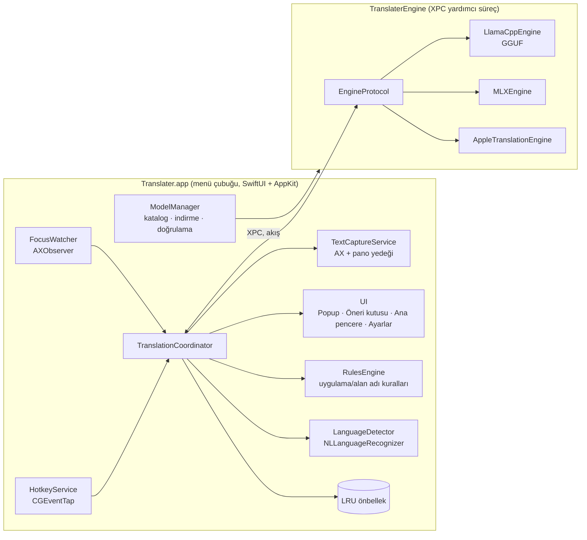

# Mimari Plan

> Durum: Taslak v0.1 · 2026-11-01
> Proje adı geçicidir ("Translater").

Translater, macOS için açık kaynaklı ve ücretsiz bir çeviri uygulamasıdır. Tüm çeviriler kullanıcının bilgisayarına indirilen yerel bir AI modeliyle yapılır.

- **DeepL Mac'ten aldığımız fikir:** Kısayolla her uygulamada anında çeviri.
- **Cotypist'ten aldığımız fikir:** Yazı alanını izleyip satır içinde otomatik çeviri önerisi.

---

## 1. Hedefler ve ilkeler

| İlke | Anlamı |
|---|---|
| **%100 yerel** | Metin asla cihazdan çıkmaz. Ağ yalnızca model indirme ve (isteğe bağlı) güncelleme kontrolü için kullanılır. Varsayılan olarak telemetri yoktur. |
| **Her yerde çalışır** | Accessibility API ile her uygulamadaki seçili metne ve yazı alanına erişilir. |
| **Hızlı hissettirir** | Çeviri akış (streaming) olarak gelir: ilk kelime ~300 ms içinde görünür, satır içi öneri ~700 ms içinde çıkar. |
| **Model bağımsız** | Çeviri motoru bir protokolün arkasındadır. Modeller ve çalıştırma altyapıları (runtime) değiştirilebilir. |
| **Model gömülmez** | Uygulama model içermez. Kullanıcı katalogdan model seçip indirir ve modelin lisansını kendisi kabul eder. |
| **Saygılı entegrasyon** | Şifre alanlarına dokunulmaz. Kapsam uygulama ya da alan adı bazında kapatılabilir. Asla sessizce metin değiştirilmez; her değişiklik kullanıcı onayıyla (Tab, Enter veya tıklama) yapılır. |

**Kapsam dışı (MVP):** Belge çevirisi (PDF/DOCX), bulut motorları, Windows/Linux, ses çevirisi.

---

## 2. Kullanım modları

### Mod A — Hızlı Çeviri (DeepL ⌘C+C)
1. Kullanıcı herhangi bir uygulamada metin seçer ve **⌘C'ye iki kez** basar (iki basış arası en fazla 400 ms).
2. İmlecin yanında küçük bir **açılır pencere** belirir. Kaynak dil otomatik algılanır, hedef dil son kullanılan ya da varsayılan dildir. Çeviri akış halinde dolar.
3. Kullanıcının seçenekleri:
   - **Kopyala**: ⌘C
   - **Yerine yaz**: ⌘↩ (yalnızca alan düzenlenebilirse)
   - **Dil değiştir**: ⌘L
   - **Ana pencerede aç**: ⌘O
   - **Kapat**: Esc

### Mod B — Yazdığını Çevir (DeepL ⌘⇧C+C)
1. Kullanıcı düzenlenebilir bir alanda yazarken **⌘⇧C'ye iki kez** basar.
2. Seçim varsa seçili metin, yoksa alandaki metnin tamamı ya da imlecin bulunduğu paragraf alınır.
3. Hedef dil seçilir (hızlı seçim: 1–9 tuşları).
4. Çeviri önizlenir. **↩** ile metin alanda çeviriyle değiştirilir; değişiklik ⌘Z ile geri alınabilir.

### Mod C — Satır İçi Çeviri Önerisi (Cotypist tarzı)
1. Kullanıcı bir uygulama veya alan adı için hedef dil tanımlar. Örnek kurallar:
   - "Slack #global kanalında İngilizce"
   - "Gmail'de alıcının diliyle" (ileri faz)
2. Kullanıcı yazarken uygulama algılanan dili kontrol eder. **Yazılan dil hedef dilden farklıysa** ve kullanıcı yazmaya ara verirse (~400 ms, cümle sonu ya da Enter öncesi), imlecin altında **yarı saydam bir öneri kutusu** gösterilir.
3. Kısayollar:

| Tuş | Ne yapar |
|---|---|
| **Tab** | Yazılan cümleyi ya da paragrafı çeviriyle değiştirir |
| **⌥Tab** | Uygulamaya gerçek Tab gönderir |
| **Esc** | Öneriyi kapatır ve o alanda birkaç saniye sessiz kalır |
| Yazmaya devam etmek | Öneri geçersiz olur ve yeniden hesaplanır |

4. Ctrl+Opt+Cmd+T ile o uygulamada geçici olarak açılıp kapatılır.

> Not: Cotypist "devam metni" önerir. Biz ise "dönüşüm" öneriyoruz, yani mevcut metni çeviriyle değiştiriyoruz. Bu yüzden imleç içine hayalet metin yerine **imleç altında bir öneri kutusu** ana tasarımdır. Daha ileri bir fazda, hedef dilde yazarken tamamlama (Cotypist'in birebir davranışı) eklenebilir.

---

## 3. Üst düzey mimari



> **Faz 1 uygulaması:** XPC servisi yerine uygulama, `llama-server`'ı (llama.cpp) bir **alt süreç** olarak başlatıp yerel bir HTTP portu üzerinden konuşuyor. Ollama da aynı OpenAI uyumlu arayüzle ikinci bir motor seçeneği. Aşağıdaki gerekçeler bu yapı için de geçerli; XPC'ye geçiş, llama.cpp kütüphane olarak gömülürse yeniden değerlendirilecek.

### Neden ayrı bir süreç?
- Model 2–20 GB bellek kullanabilir. Çökme ya da bellek taşması (OOM) ana uygulamayı ve kısayolları düşürmemeli.
- Model, boşta kalınca bellekten bağımsız olarak boşaltılabilir.
- Çalıştırma altyapısı (llama.cpp veya MLX) ileride uygulamaya dokunmadan değiştirilebilir.

---

## 4. Bileşenler

### 4.1 HotkeyService
- `CGEventTap` (`kCGSessionEventTap`, `keyDown` ve `flagsChanged` olayları) ile global klavye dinlenir.
- **Çift ⌘C algılama:** İlk ⌘C uygulamaya normal şekilde iletilir, ikinci ⌘C süre penceresi içinde gelirse tetiklenir. Böylece uygulamanın kendi kopyalama davranışı bozulmaz.
- **Tab, Esc ve ⌥Tab** yalnızca bir öneri görünürken yakalanıp tüketilir; aksi halde olduğu gibi geçirilir.
- Kısayollar ayarlardan değiştirilebilir. Klasik global kısayollar için `KeyboardShortcuts` kütüphanesi kullanılabilir. Çift basış mantığı ise özel kodla yazılmalı.
- Gerekli izinler: Accessibility. Yalnızca dinleme yapan tap için Input Monitoring de yeterli olabilir.

### 4.2 TextCaptureService
Metin almak ve yazmak için bir öncelik sırası izlenir:

| İşlem | 1. yol (tercih) | 2. yol (yedek) |
|---|---|---|
| Odaktaki elemanı bul | Öndeki uygulamanın `AXUIElement`'i → `kAXFocusedUIElementAttribute` | Sistem geneli eleman (macOS 27'de `-25204` veriyor, bkz. `prototypes/ax-probe`) |
| Seçili metni oku | `AXFocusedUIElement` → `kAXSelectedTextAttribute` | Panoyu yedekle → ⌘C simüle et → oku → panoyu geri yükle |
| Alan metnini oku | `kAXValueAttribute` + `kAXSelectedTextRangeAttribute` | — |
| İmleç konumu | `kAXBoundsForRangeParameterizedAttribute` | Fare konumu / pencere merkezi |
| Metni değiştir | `kAXSelectedTextAttribute` yaz | Panoyu yedekle → yapıştır (⌘V) → panoyu geri yükle |

- **Güvenlik:** `AXSecureTextField` ve şifre alanları her zaman atlanır.
- **Uyumluluk katmanı:** Uygulamaya özel davranışlar ayrı bir dosyada (`AppQuirks`) tutulur. Bilinen örnekler:
  - Chromium tabanlı tarayıcılarda erişilebilirlik ağacının açılması gerekir (`AXEnhancedUserInterface` / `AXManualAccessibility`).
  - Google Docs'ta ekran okuyucu modu açık olmalıdır.
  - Electron uygulamaları da AX desteğini etkinleştirmeyi gerektirir.

### 4.3 FocusWatcher (Mod C)
- Sistem genelinde `kAXFocusedUIElementChangedNotification` izlenir.
- Odaktaki alan için `AXObserver` ile `kAXValueChangedNotification` dinlenir.
- Her metin değişikliğinde bir **debounce** zamanlayıcısı kurulur:

  ```
  text değişti → aktif segmenti çıkar (imlecin bulunduğu cümle/paragraf)
              → kural var mı? dil farklı mı? min. uzunluk (≥ 3 kelime)?
              → 400 ms sessizlik → çeviri iste (önceki istek iptal)
  ```
- Kullanıcı yazmaya devam ederse istek iptal edilir. Bunun için XPC tarafında **iptal desteği** zorunludur.

### 4.4 TranslationCoordinator
Uygulamanın beyni. Görevleri:
- Modu belirler (A/B/C).
- Dili algılar.
- Önbelleğe bakar.
- Motoru seçer: hızlı çeviri (Mod A/B) ile canlı öneri (Mod C) farklı modeller kullanabilir.
- Akışı UI'a iletir.
- Değiştirme işlemini yürütür.

Swift Concurrency (`actor`, `AsyncThrowingStream`, `Task` iptali) ile yazılır.

### 4.5 Çeviri motoru katmanı

```swift
protocol TranslationEngine: Sendable {
    var id: String { get }
    var capabilities: EngineCapabilities { get }   // diller, streaming, glossary, formality
    func load(model: InstalledModel) async throws
    func unload() async
    func translate(_ request: TranslationRequest) -> AsyncThrowingStream<String, Error>
}

struct TranslationRequest: Sendable {
    let text: String
    let source: Language?        // nil → otomatik
    let target: Language
    let formality: Formality?    // .formal / .informal / nil
    let glossary: [GlossaryEntry]
    let context: String?         // çevre metin (ileri faz)
}
```

| Uygulama | Durum | Not |
|---|---|---|
| `LlamaCppEngine` | **MVP** | GGUF modeller, Metal hızlandırma. Faz 1'de `llama-server` alt süreci + `OpenAICompatibleEngine` olarak uygulandı. Platformlar arası taşınabilir olduğu için ana motor. |
| Ollama | **MVP** | Kullanıcının Ollama'daki modellerini indirme yapmadan kullanır. Not: Ollama'nın model dosyaları llama.cpp ile uyumlu değil, bu yüzden paylaşılamıyor. |
| `MLXEngine` | Faz 2 | `mlx-swift` / MLXLLM. Apple Silicon'da en hızlısı olabilir; karşılaştırmalı ölçümle karar verilir. |
| `AppleTranslationEngine` | Faz 2 | macOS 15+ `Translation` framework'ü. Sıfır indirme yedeği. API kısıtları yüzünden yalnızca seçenek olarak sunulur. |
| `CTranslate2Engine` | Değerlendirme | Opus-MT / MADLAD için. Mod C'de gecikme sorun olursa eklenir. |

**Prompt şablonları** modele özel olarak katalogda tutulur (TranslateGemma'nın kendi sohbet şablonu var; Qwen ve Gemma için genel bir talimat şablonu kullanılır). Şablonun sabit kısmı **KV önbellek ön eki** olarak yeniden kullanılır. Bu, ilk kelimenin gelme süresini ciddi ölçüde düşürür.

**Performans kuralları:**
- Model uygulama açılırken *ısıtılır*. N dakika boşta kalırsa bellekten boşaltılır (ayarlanabilir).
- Aynı anda tek üretim çalışır; yeni istek gelince eskisi iptal edilir.
- Mod C için çıktı uzunluğu sınırlanır (`max_tokens` ≈ girdi uzunluğu × 2).

### 4.6 ModelManager
- **Katalog:** Repoda bir `models/catalog.json` dosyası (aynı dosya uygulamaya da gömülür, uzaktan güncellenebilir). Örnek kayıt:

  ```json
  {
    "id": "translategemma-4b-q4km",
    "family": "TranslateGemma",
    "runtime": "llamacpp",
    "url": "https://huggingface.co/.../translategemma-4b-it-Q4_K_M.gguf",
    "sha256": "...",
    "sizeBytes": 2600000000,
    "minRAMGB": 8,
    "languages": ["tr","en","de", "..."],
    "license": { "name": "Gemma Terms of Use", "url": "...", "requiresAcceptance": true },
    "promptTemplate": "translategemma",
    "tier": "fast"
  }
  ```

- **İndirme:** `URLSession` ile arka planda, yarıda kalırsa devam edebilen indirme, SHA-256 doğrulaması. Dosyalar `~/Library/Application Support/Translater/Models/` altına kaydedilir.
- **Donanım önerisi:** RAM ve çip bilgisine bakarak "Önerilen" etiketi verilir. Örneğin 8 GB'ta 4B, 16 GB'ta 12B, 32 GB ve üzerinde 27B.
- **Kendi modelini ekle:** Kullanıcı yerel bir GGUF dosyası seçebilir (ileri kullanıcılar için).

**Başlangıç kataloğu** (karşılaştırmalı ölçüm sonucuna göre kesinleşecek):

| Kademe | Model | Lisans |
|---|---|---|
| Hızlı (varsayılan) | Gemma 4 E4B Q4 *(Faz 0'da en iyi; bkz. `tools/bench/RESULTS.md`)* | Gemma |
| Hızlı (alternatif) | TranslateGemma 4B Q4 / Qwen 3 4B Q4 *(Türkçede zayıf kaldılar)* | Gemma / Apache 2.0 |
| Kalite | TranslateGemma 12B / 27B Q4 | Gemma |
| Kalite (Apache) | Mistral Small 3.2 24B / Qwen 3 30B-A3B | Apache 2.0 |
| Deneysel | Hunyuan-MT 7B *(AB/UK/KR dışı lisans uyarısıyla)* | Tencent |

### 4.7 LanguageDetector
- `NaturalLanguage.NLLanguageRecognizer` kullanılır; hızlı ve yereldir.
- Kısa metinlerde güven eşiği uygulanır. Eşik altında kalınırsa son kullanılan dil ya da kullanıcının ana dili varsayılır.
- Kullanıcı, dil çiftleri için "TR ↔ EN otomatik yön" kuralı tanımlayabilir: kaynak Türkçeyse hedef İngilizce, değilse Türkçe olur.

### 4.8 RulesEngine ve Ayarlar
- Kurallar uygulama bazında (bundle id), alan adı bazında (tarayıcı URL'si AX'ten okunur) ve ileride pencere başlığına göre tanımlanır. Her kural şunları içerir: Mod C açık/kapalı, hedef dil, resmi/samimi hitap, Tab davranışı.
- **Varsayılan olarak kapalı:** Terminaller, kod editörleri, şifre yöneticileri.
- Saklama: Basit ayarlar `UserDefaults`'ta; kurallar, sözlük ve (isteğe bağlı) geçmiş yerel bir SQLite dosyasında (GRDB) tutulur.

### 4.9 UI
| Yüzey | Teknoloji | Not |
|---|---|---|
| Menü çubuğu simgesi | `MenuBarExtra` | Durum, hızlı aç/kapa, model seçimi |
| Hızlı çeviri popup'ı | `NSPanel` (`.nonactivatingPanel`, `.floating`) + SwiftUI | Odağı çalmaz; imleç ya da seçimin yanına konumlanır |
| Öneri kutusu | Kenarlıksız, fare tıklamalarını geçiren `NSPanel` | İmleç dikdörtgeninin altına konumlanır; ekran kenarından taşmaz |
| Ana pencere | SwiftUI | DeepL tarzı iki panelli çeviri ekranı, geçmiş |
| Ayarlar | SwiftUI `Settings` | Genel · Kısayollar · Modeller · Kurallar · Sözlük · Gizlilik |
| İlk kurulum | SwiftUI | İzin rehberi, model seçimi ve indirme, kısayol tanıtımı |

---

## 5. Veri akışları

### Mod A — ⌘C+C
```
HotkeyService (çift ⌘C)
 → TextCapture.selectedText()           // AX, yoksa pano
 → LanguageDetector.detect()
 → Cache hit? → UI.show(result)
 → XPC.translate(stream) → UI.popup.append(token)
 → kullanıcı: Kopyala | Yerine yaz (TextCapture.replaceSelection)
```

### Mod C — Satır içi öneri
```
FocusWatcher(valueChanged) → debounce 400ms
 → Rules.match(bundleId, domain) → hedef dil var mı?
 → segment = currentSentence(value, caretRange)
 → detect(segment) ≠ hedef? && len ≥ min
 → XPC.translate(segment, tier: .fast) (iptal edilebilir)
 → UI.suggestion.show(at: caretRect)
 → Tab → TextCapture.replace(range: segmentRange, with: translation)
```

---

## 6. İzinler ve dağıtım

| İzin | Neden | Zorunlu mu? |
|---|---|---|
| Accessibility | Metin okuma/yazma, event tap | Evet |
| Input Monitoring | Bazı sistemlerde klavye dinleme için | Duruma göre |
| Ağ | Yalnızca model indirme / güncelleme | Model indirmek için |
| Ekran Kaydı | Çevre bağlamı için OCR (ileri faz) | Hayır |

- **App Store dışı dağıtım:** Accessibility ve event tap kullanımı App Sandbox ile pratikte uyumsuz. Developer ID ile imzalanıp **notarize edilmiş DMG** olarak GitHub Releases üzerinden dağıtılır.
- Güncellemeler **Sparkle 2** ile yapılır (EdDSA imzalı appcast, GitHub Pages).
- Homebrew cask (`brew install --cask translater`) Faz 2'de eklenir.
- Minimum sürüm: **macOS 14 Sonoma** ve **Apple Silicon**. Intel desteklenmez (Cotypist ile aynı).

---

## 7. Proje yapısı

Faz 1'de Xcode projesi yerine tek bir SwiftPM paketi kullanılıyor. `scripts/build-app.sh` bunu imzalı bir `.app` paketine dönüştürür. Paket Xcode'da da açılabilir (`Package.swift`).

```
translater/
├── Package.swift
├── Sources/
│   ├── TranslaterCore/       # Language, TranslationRequest, PromptTemplate, DoublePressDetector, katalog tipleri
│   ├── Engines/              # OpenAICompatibleEngine (akış), LlamaServer (alt süreç), Ollama
│   ├── ModelManager/         # ModelStore: katalog, indirme, SHA-256 doğrulama, donanım bilgisi
│   ├── SystemIntegration/    # HotkeyMonitor (event tap), TextCapture (AX + pano), Permissions
│   └── Translater/           # Menü çubuğu uygulaması: AppModel, EngineController, UI/
├── Tests/                    # Swift Testing; ağ ve model testleri ortam değişkeniyle açılır
├── models/catalog.json       # Model kataloğu (uygulamaya gömülür)
├── scripts/build-app.sh      # build/Translater.app üretir ve imzalar
├── prototypes/ax-probe/      # Faz 0 prototipi
├── tools/bench/              # Model karşılaştırma aracı
└── docs/
```

**Teknoloji:** Swift 6, SwiftUI + AppKit, Swift Concurrency, Swift Testing, llama.cpp (`llama-server`). Planlananlar: GRDB (geçmiş), Sparkle (güncelleme), özelleştirilebilir kısayollar.

---

## 8. Test ve kalite

- **Birim testleri:** Segment çıkarma, çift basış algılama zamanlaması, kural eşleşmesi, prompt şablonları.
- **Entegrasyon testleri:** Test amaçlı bir `NSTextView` uygulaması üzerinde AX ile okuma/yazma.
- **Uyumluluk matrisi:** Hangi uygulamada neyin çalıştığını gösteren elle güncellenen bir tablo (`docs/COMPATIBILITY.md`). Hedef uygulamalar: Safari, Chrome, Slack, Mail, Notes, Notion, VS Code, WhatsApp, Teams, Word.
- **Model karşılaştırma aracı (`tools/bench`):** TR↔EN, TR↔DE, EN↔DE yönlerinde ~200 cümlelik bir set üzerinde çalışır. Ölçülen değerler:
  - Kalite: COMET / chrF
  - Hız: ilk kelimenin gelme süresi, token/s
  - Bellek: tepe RAM kullanımı

  Sonuçlar katalogdaki "Önerilen" etiketini belirler.

---

## 9. Yol haritası

| Faz | İçerik | Çıktı |
|---|---|---|
| **0 — Doğrulama** | Model karşılaştırma CLI'ı; llama.cpp ve MLX hız karşılaştırması; AX prototipi (seçili metni oku/yaz) | Model ve motor kararı |
| **1 — MVP** | Menü çubuğu uygulaması, ModelManager, Mod A (⌘C+C popup), ana çeviri penceresi, ilk kurulum | v0.1 GitHub Release |
| **2 — Yerine yazma** | Mod B (⌘⇧C+C), resmi/samimi hitap, geçmiş, Sparkle, Homebrew, MLX motoru | v0.2 |
| **3 — Satır içi öneri** | Mod C, RulesEngine, uygulama/alan adı kuralları, uyumluluk katmanı | v0.3 |
| **4 — Yazım asistanı** | Sözlük, yeniden ifade etme ve ton değiştirme (DeepL Write benzeri), hedef dilde tamamlama | v0.4 |
| **5 — Genişleme** | Ekran bağlamı (OCR), belge çevirisi, Windows/Linux (motor katmanı paylaşılır, sistem entegrasyonu yeniden yazılır) | v1.x |

---

## 10. Açık kararlar

1. **Proje adı ve lisansı:** MIT, Apache-2.0 ya da GPL-3.0. Öneri: rakip ticari kopyalar istenmiyorsa GPL-3.0, katkı ve dağıtımı kolaylaştırmak için Apache-2.0.
2. **Doküman dili:** Daha geniş katkı için İngilizce mi olsun, Türkçe ve İngilizce birlikte mi?
3. **MLX mi llama.cpp mi?** Faz 0 ölçümlerine göre belirlenir; ikisi de protokol arkasında kalır.
4. **Mod C'de varsayılan:** Öneri kutusu mu, satır içi hayalet metin mi? Kullanıcı testine göre belirlenir.
5. **Hunyuan-MT** lisansı nedeniyle katalogda yer almalı mı?
